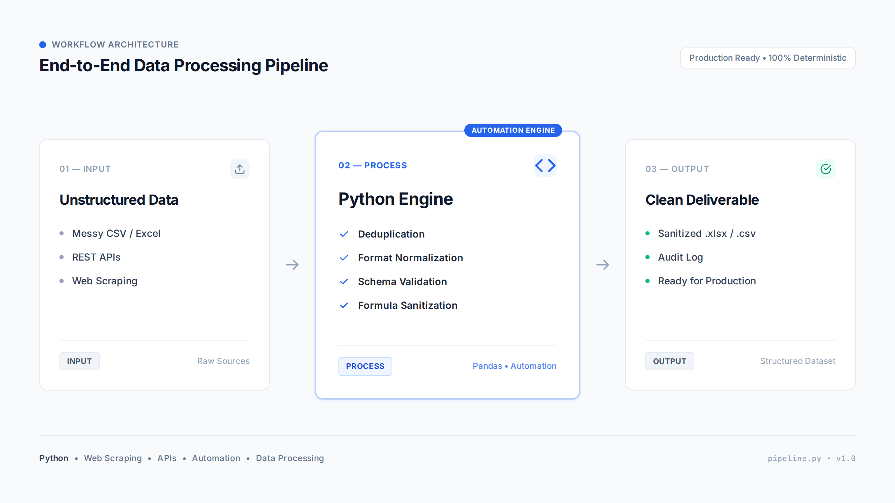
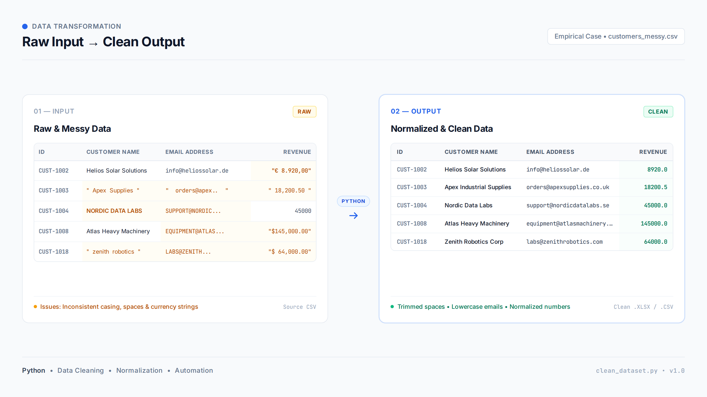

# Data Processing Tool

A deterministic Python data cleaning pipeline and REST API for standardizing, validating, and repairing business CSV and Excel (`.xlsx`) datasets.

[](https://github.com/sergiochillon/data-automation-demo/actions)
[](https://www.python.org/downloads/)
[](https://fastapi.tiangolo.com)
[](https://pandas.pydata.org)
[](https://github.com/astral-sh/ruff)
[](LICENSE)

---

## What is this project?

In administrative and operational workflows, spreadsheets exported from CRMs, ERPs, accounting software, or web forms frequently contain quality defects:

- Mixed or all-caps casing in names and email addresses.
- Redundant leading, trailing, or repeated whitespace.
- Clashing numeric and currency formats (such as European `1.250,50` vs. US `1,250.50`).
- Completely blank rows and columns.
- Exact duplicate records that distort metrics.
- CSV formula injection risks caused by spreadsheet formula characters that may be interpreted when files are opened in spreadsheet applications.

**Data Processing Tool** provides a deterministic backend pipeline that accepts uploaded `.csv` or `.xlsx` files, applies explicit normalization rules, flags unparseable records without discarding them, and generates clean downloadable files accompanied by an itemized audit log.

---

## Visual Architecture & Pipeline Flow

The processing pipeline executes sequential cleaning steps:

```
┌─────────────────────────────────┐
│         RAW INPUT FILE          │
│    - .csv or .xlsx              │
│    - Delimiter: comma, semi, tab│
│    - Encoding: UTF-8, Latin-1   │
└────────────────┬────────────────┘
                 │
                 ▼
┌─────────────────────────────────────────────────────────────┐
│                   DATA CLEANING PIPELINE                    │
│                                                             │
│  1. Format & Encoding Sniffing (UTF-8, UTF-8-SIG, Latin-1)  │
│  2. Structural Cleanup (Drop blank rows & blank columns)    │
│  3. Text Trimming (Strip spaces, collapse multi-spaces)     │
│  4. Formula Injection Sanitization (Prefix unsafe formulas) │
│  5. Field-Specific Rules:                                   │
│     - Email lowercasing and regex syntax check              │
│     - Name title-casing (preserves mixed-case names)        │
│     - Currency & numeric parsing (US, EU, negative values)  │
│  6. Exact Deduplication (First occurrence retained)         │
│  7. Audit Metrics & Warning Compilation                     │
└────────────────┬────────────────────────────────────────────┘
                 │
                 ▼
┌─────────────────────────────────┐
│        CLEAN DELIVERABLES       │
│    - Normalized CSV (.csv)      │
│    - Normalized Excel (.xlsx)   │
│    - Quantitative audit report  │
└─────────────────────────────────┘
```

---

## Portfolio Visuals

The repository includes visual reference assets illustrating the pipeline architecture and a before-and-after data transformation:

| Pipeline Overview | Data Transformation Comparison |
| :---: | :---: |
|  |  |
| *Three-stage data processing pipeline.* | *Side-by-side comparison using records from the demo dataset.* |

---

## Real Example

The project includes a sample messy dataset (`demo_data/customers_messy.csv`) containing 31 rows with deliberate formatting inconsistencies.

### Sample Input (`demo_data/customers_messy.csv`)

```csv
customer_id,name,email,city,country,phone,revenue,status,notes_internal
CUST-1002,Helios Solar Solutions,info@heliossolar.de,Munich,Germany,+49-89-555-0199,€ 8.920,00,Active,
,,,,,,,,
CUST-1003,  Apex   Industrial Supplies  ,   orders@apexsupplies.co.uk  ,Manchester,United Kingdom,+44-161-555-0177, 18,200.50 ,Pending,
CUST-1004,NORDIC DATA LABS,SUPPORT@NORDICDATALABS.SE,Stockholm,Sweden,+46-8-555-0182,45000,Active,
CUST-1004,NORDIC DATA LABS,SUPPORT@NORDICDATALABS.SE,Stockholm,Sweden,+46-8-555-0182,45000,Active,
CUST-1005,Meridian Maritime Inc,maritime_sales_at_meridian.com,Rotterdam,Netherlands,+31-10-555-0124,€ 24.150,00,Active,
CUST-1012,=SUM(A1:A50),finance@riskycorp.com,Dublin,Ireland,+353-1-555-0189,$15,000.00,Review,
CUST-1020,Beacon Pharma Labs,procurement@beaconpharma.com,Boston,United States,+1-617-555-0193,UNKNOWN_PENDING,Under Review,
```

### Applied Changes & Output

- **Empty Rows**: 3 completely blank rows removed.
- **Empty Columns**: 1 empty column (`notes_internal`) removed.
- **Deduplication**: 3 exact duplicate rows removed.
- **Whitespace**: Internal repeated spaces collapsed (e.g. `"  Apex   Industrial Supplies  "` becomes `"Apex Industrial Supplies"`).
- **Casing**: `"NORDIC DATA LABS"` converted to Title Case (`"Nordic Data Labs"`); `"SUPPORT@NORDICDATALABS.SE"` normalized to lowercase.
- **Currency & Numbers**: `"€ 8.920,00"` converted to `8920.0`; `" 18,200.50 "` converted to `18200.5`.
- **Formula Injection**: `"=SUM(A1:A50)"` neutralized to `'=SUM(A1:A50)`.
- **Quality Warnings**: Non-standard values are retained and flagged for review:
  - Row 6: `maritime_sales_at_meridian.com` (missing `@`).
  - Row 7: `reservations@starlight` (missing top-level domain).
  - Row 22: `UNKNOWN_PENDING` (non-numeric string in revenue column).
- **Final Result**: 25 clean rows ready for export.

---

## Key Capabilities

### Ingestion & Format Support
- Supports `.csv` and modern Excel `.xlsx` files.
- Automatically attempts delimiter detection (comma `,`, semicolon `;`, tab `\t`, pipe `|`).
- Falls back through text encodings: `utf-8-sig` (with BOM), `utf-8`, `latin-1` (`iso-8859-1`), and `cp1252`.
- Detects and rejects binary files containing null bytes when uploaded as CSV.

### Data Cleaning & Normalization
- **Structure**: Drops rows and columns that are entirely blank or contain only whitespace. Trims leading and trailing spaces from header names.
- **Whitespace**: Strips leading/trailing spaces and collapses consecutive internal whitespace characters into single spaces.
- **Email Hygiene**: Normalizes email addresses to lowercase and runs a practical regex syntax check (`^[a-zA-Z0-9_.+-]+@[a-zA-Z0-9-]+\.[a-zA-Z0-9-.]+$`).
- **Name Casing**: Converts uppercase or lowercase names to Title Case while preserving intentional mixed casing (such as `McDonald` or `van der Waals`).
- **Numbers & Currency**: Strips currency signs (`$`, `€`, `£`, `¥`), handles both US decimal format (`1,250.50`) and European format (`1.250,50`), and parses negative financial numbers (`-$450.25` or `($1,250.00)`).
- Plain decimal syntax such as `.5` and `1.` is also accepted and normalized to a float.
- **Deduplication**: Drops exact duplicate rows while preserving the first instance.

### Security & Input Handling
- **CSV Formula Injection**: Detects string cells beginning with formula trigger characters (`=`, `+`, `-`, `@`, `\t`, `\r`). Unless the string is a valid numeric value or an international phone number, a leading single quote (`'`) is prepended to prevent spreadsheet execution.
- **Filename Validation & Path Traversal Defense**: Rejects filenames with directory separators (`/`, `\`, `..`) or null bytes.
- **Upload Size Ceiling**: Enforces a configurable 15 MB maximum file size (`MAX_UPLOAD_SIZE_MB`).
- **Streaming Upload**: Streams incoming request data in 1 MB chunks to prevent unbounded memory usage during uploads.
- **Artifact Access**: Stores export files under randomly generated UUID4 directory names. File retrieval checks verify that requested paths remain strictly within the target storage directory using `is_relative_to`.
- **Temporary File Lifecycle**: Automatically deletes processed file directories older than a configurable retention window (default 3600 seconds).

---

## Technical Stack

- **Backend**: Python 3.12+, FastAPI, Uvicorn, pandas, openpyxl, Pydantic v2.
- **Frontend**: Semantic HTML5, CSS3, Vanilla JavaScript (no build step or frontend framework).
- **Code Quality**: Ruff (linter and formatter), pytest, HTTPX (TestClient).
- **Deployment**: Docker, Docker Compose (runs as non-root user `appuser` with a Python-based healthcheck).

---

## Project Structure

```text
data-automation-demo/
├── .github/
│   └── workflows/
│       └── ci.yml               # GitHub Actions CI workflow (Ruff + Pytest)
├── app/
│   ├── __init__.py
│   ├── config.py                # Paths, upload limits, logging setup
│   ├── main.py                  # FastAPI application, routing, lifespan
│   ├── models.py                # Pydantic schemas (metrics, results, health)
│   ├── processor.py             # Data cleaning pipeline and transformation rules
│   ├── security.py              # Formula escaping, UUID and filename checks
│   ├── storage.py               # Temporary artifact persistence and cleanup
│   └── static/
│       ├── css/
│       │   └── style.css        # Clean stylesheet
│       ├── js/
│       │   └── app.js           # Vanilla JavaScript UI controller
│       └── index.html           # Single-page interface
├── demo_data/
│   ├── generate_demo_data.py    # Demo data generator script
│   ├── customers_messy.csv      # Sample messy CSV dataset
│   └── customers_messy.xlsx     # Sample messy Excel dataset
├── storage/
│   └── processed/               # Local processed files directory (.gitignore)
├── tests/
│   ├── conftest.py              # Test fixtures and sample byte payloads
│   ├── test_api.py              # API endpoint integration tests
│   ├── test_processor.py        # Unit tests for data cleaning logic
│   ├── test_security.py         # Tests for security validations and sanitization
│   └── test_storage.py          # Tests for storage management and pruning
├── Dockerfile                   # Non-root container definition
├── docker-compose.yml           # Compose configuration
├── pyproject.toml               # Project metadata and Ruff configuration
├── pytest.ini                   # Pytest configuration
├── requirements.txt             # Runtime and development dependency ranges
├── LICENSE                      # MIT License
├── pipeline.png                 # Portfolio visual: architecture diagram
├── before-after.png             # Portfolio visual: data transformation
└── README.md
```

---

## Local Setup & Execution

### Prerequisites
- Python 3.12 or higher
- Git

### Installation
```bash
# Clone repository
git clone https://github.com/sergiochillon/data-automation-demo.git
cd data-automation-demo

# Create and activate virtual environment
python3 -m venv .venv
source .venv/bin/activate

# Install dependencies
pip install -r requirements.txt
```

### Run the Application
```bash
uvicorn app.main:app --host 0.0.0.0 --port 8000 --reload
```

Access the application in your browser:
- Web Interface: [http://localhost:8000](http://localhost:8000)
- Interactive API Docs (Swagger UI): [http://localhost:8000/docs](http://localhost:8000/docs)
- Health Check Endpoint: [http://localhost:8000/api/health](http://localhost:8000/api/health)

### Quick Demo
Upload `demo_data/customers_messy.csv` or `demo_data/customers_messy.xlsx` in the web interface. The sample demonstrates blank-row removal, duplicate removal, normalization, formula sanitization, and audit warnings. You can also send the CSV to the API:

```bash
curl -F "file=@demo_data/customers_messy.csv" http://localhost:8000/api/process
```

The response includes processing metrics, warnings, a preview, and CSV/XLSX download URLs. Open the web interface at `http://localhost:8000` for the simplest end-to-end walkthrough.

---

## Running with Docker

### Using Docker Compose
```bash
docker compose up --build -d
```

### Using Docker Directly
```bash
# Build image
docker build -t data-automation-demo:latest .

# Run container
docker run -d \
  --name data_automation_demo \
  -p 8000:8000 \
  -e MAX_UPLOAD_SIZE_MB=15 \
  -e STORAGE_RETENTION_SECONDS=3600 \
  data-automation-demo:latest
```

The container runs as a non-root user (`appuser`, UID 1001) and includes a healthcheck that polls `/api/health` every 30 seconds using Python's standard `urllib.request`.

---

## Testing & Code Quality

The codebase is checked using Ruff and tested with pytest:

```bash
# Linting check
ruff check .

# Formatting check
ruff format --check .

# Run test suite
pytest -v
```

Expected output:
```text
============================== 48 passed ==============================
```

The 48 tests cover:
- CSV delimiter detection (comma, semicolon, tab, pipe).
- Multi-encoding support (UTF-8, UTF-8-SIG with BOM, Latin-1/ISO-8859-1).
- Empty row and column removal.
- Exact duplicate elimination.
- Email normalization and regex syntax verification.
- International currency and negative number formatting.
- Ambiguous numeric parsing detection (e.g., `1,234` and `1.234`) with original value preservation and warning generation.
- Name casing normalization while preserving mixed-case identifiers.
- CSV formula injection sanitization.
- Upload size limits (HTTP 413) and disallowed extension handling (HTTP 400).
- Filename path traversal prevention (including Unicode support) and UUID validation.
- Storage artifact management and expiration pruning with isolated test execution.
- CORS policy configuration without credential exposure.

---

## API Reference

### `GET /api/health`
Returns service status.

**Response `200 OK`**:
```json
{
  "status": "healthy",
  "version": "1.0.0",
  "service": "data-automation-demo"
}
```

### `POST /api/process`
Uploads and processes a `.csv` or `.xlsx` file (max 15 MB).

- **Content-Type**: `multipart/form-data`
- **Field**: `file`

**Response `200 OK` (Example from `customers_messy.csv`)**:
```json
{
  "file_id": "4d9cf315-ccb3-4cb2-ba1c-bad12a2d1819",
  "original_filename": "customers_messy.csv",
  "processed_at": "2026-10-04T21:01:26.643843+00:00",
  "metrics": {
    "rows_initial": 31,
    "rows_final": 25,
    "rows_removed_empty": 3,
    "columns_removed_empty": 1,
    "duplicate_rows_removed": 3,
    "invalid_emails_count": 2,
    "invalid_values_detected": 3,
    "fields_normalized": 45,
    "null_values_count": 2,
    "processing_time_ms": 28.23
  },
  "changes_summary": [
    "Removed 1 completely empty column(s): notes_internal",
    "Removed 3 completely empty row(s)",
    "Cleaned whitespace across 4 text cell(s)",
    "Sanitized 2 cell(s) starting with formula characters",
    "Normalized casing for 9 name(s) in 'name'",
    "Normalized 6 email address(es) to lowercase in 'email'",
    "Normalized 26 currency/numeric value(s) in 'revenue'",
    "Removed 3 exact duplicate row(s)",
    "Flagged 2 potentially invalid email address(es)"
  ],
  "warnings": [
    "Row 6: Potentially invalid email 'maritime_sales_at_meridian.com' in column 'email'",
    "Row 7: Potentially invalid email 'reservations@starlight' in column 'email'",
    "Row 22: Unrecognized numeric format 'UNKNOWN_PENDING' in column 'revenue'"
  ],
  "columns": [
    "customer_id",
    "name",
    "email",
    "city",
    "country",
    "phone",
    "revenue",
    "status"
  ],
  "sample_preview": [
    {
      "customer_id": "CUST-1001",
      "name": "Vanguard Logistics",
      "email": "contact@vanguardlogistics.com",
      "city": "Chicago",
      "country": "United States",
      "phone": "+1-312-555-0143",
      "revenue": 12450.0,
      "status": "Active"
    }
  ],
  "csv_download_url": "/api/download/4d9cf315-ccb3-4cb2-ba1c-bad12a2d1819/csv",
  "xlsx_download_url": "/api/download/4d9cf315-ccb3-4cb2-ba1c-bad12a2d1819/xlsx"
}
```
*Note: `processing_time_ms` is an execution metric that varies depending on host environment and CPU load.*

### `GET /api/download/{file_id}/{file_format}`
Downloads the cleaned file in `csv` or `xlsx` format.

- **Parameters**:
  - `file_id`: UUID4 returned by `/api/process`.
  - `file_format`: `csv` or `xlsx`.
- **Response**: File download stream.
- **Errors**:
  - `400 Bad Request`: Invalid UUID format or unsupported export format.
  - `404 Not Found`: File not found or expired.

---

## Design Decisions

- **Stateless Local File Storage**: Exported files are written to local disk under UUID4 directory names with an automatic 1-hour expiration TTL. This keeps the application self-contained without requiring an external database or caching service.
- **Conservative Data Mutation**: If a value cannot be parsed unambiguously (such as `UNKNOWN_PENDING` or ambiguous numeric formats like `1,234` and `1.234` where decimal vs. thousands separators cannot be determined without locale metadata), the processor preserves the raw value without mutation and registers an itemized warning rather than silently guessing or coercing values.
- **Lightweight Frontend**: The browser interface uses semantic HTML5, CSS, and Vanilla JavaScript, avoiding external build steps or frontend framework dependencies.

---

## Limitations

- **In-Memory Processing & Upload Limit**: Datasets are loaded in memory using pandas DataFrames. The application enforces a 15 MB upload limit to prevent excessive memory consumption. For multi-gigabyte files, chunked streaming or distributed engines (such as Polars or Dask) would be required.
- **Single-Sheet Excel Files**: The engine currently processes the active (first) worksheet in `.xlsx` workbooks.
- **Heuristic Column Detection**: Column role detection (names, emails, currencies) is based on common naming keywords and string patterns. Datasets with non-standard column headers may require explicit column mapping.
- **Conservative Single-Separator Numeric Parsing**: Single-separator numeric formats with 3-digit groupings (such as `1,234` or `1.234`) cannot be resolved unambiguously without locale context (e.g. US thousands vs. European decimal). Rather than assuming a regional convention, the engine preserves the original representation and flags an explicit audit warning. Unambiguous formats (e.g. `1,234.56`, `1.234,56`, `1,234,567`) are standardized to standard floats.

---

## License

This project is licensed under the MIT License - see the [LICENSE](LICENSE) file for details.
